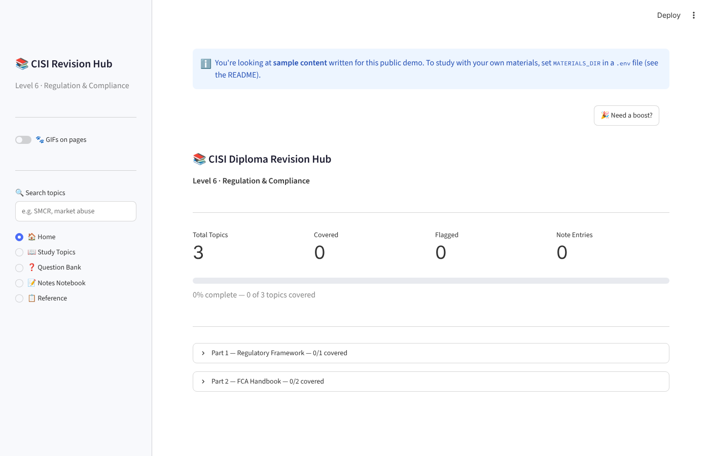
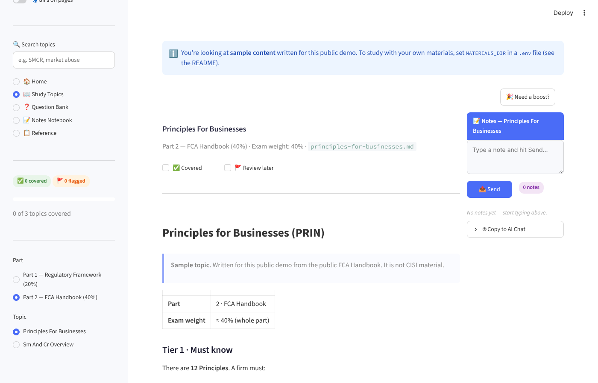
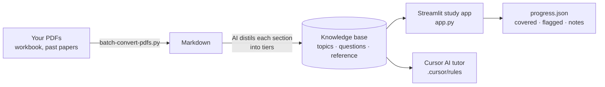

# CISI Revision Hub

**An AI-assisted study app that turns a 500-page compliance textbook into a clear, prioritised revision plan.**

I built this for my partner while she was studying for the **CISI Level 6 Regulation & Compliance** exam. It has two halves: a simple study app that runs in the browser (Streamlit), and a set of instructions that turn the Cursor editor's AI into a focused exam tutor.



---

## The problem

The official workbook is about 500 pages of dense regulatory text. Three pages might hold two or three sentences that really matter for the exam, but nothing tells you which ones. Some chapters are worth 40% of the marks and others 2.5%, yet the book gives them equal weight. The past-paper archive shows what actually gets tested, but it's far too long to read alongside everything else.

**The goal:** say *"I'm working on the Conduct Rules today"* and get only what matters, ranked by how likely it is to be tested.

## What it does

| Feature | What you get |
|---|---|
| **Tiered topics** | Every topic is split into *Must know*, *Should know* and *Awareness only*, so you know what to skip |
| **Exam weighting** | Topics are grouped by syllabus part and labelled with their share of the marks |
| **Progress tracking** | Tick topics as *Covered*, flag them *Review later*, and see a progress bar per part |
| **Notes** | A notes panel beside every topic, plus a notebook view of all your notes |
| **Search** | Search across every topic, question and reference file |
| **Question bank** | Practice questions by exam section, with model answers hidden until you click |
| **AI tutor (in Cursor)** | Four always-on rule files make Cursor's AI act as a compliance tutor: it explains topics, quizzes you, and coaches exam technique, using only your materials |



## How it works



**Your study materials are not in this repository.** They're copyrighted. The app reads them from a folder on your own computer. Without that folder it opens a small **sample** I wrote, so you can see how everything works.

---

## Quick start (Windows)

### 1. Check you have Python

Open PowerShell and run:
```powershell
python --version
```
**You should see** `Python 3.10` or higher. If not, install it from [python.org](https://www.python.org/downloads/) and tick **"Add python.exe to PATH"**.

### 2. Download and install

```powershell
git clone https://github.com/nomaan02/cisi-revision-hub.git
cd cisi-revision-hub
pip install -r requirements.txt
```
**You should see:** `Successfully installed streamlit …` (or "Requirement already satisfied").

### 3. Start the app

Double-click **`launch.bat`**, or run:
```powershell
streamlit run app.py
```
**You should see:** your browser open at `http://localhost:8501` with the home screen above, and a blue note saying you're viewing sample content.

To stop the app, close the browser tab and press **Ctrl + C** in PowerShell.

<details>
<summary><strong>Mac or Linux?</strong></summary>

Same steps, using `python3` and `pip3`, then `streamlit run app.py`. Ignore `launch.bat`.
</details>

## Using your own materials

> Only use materials you're licensed to use, and never commit them to a public repository. This project's `.gitignore` already blocks `knowledge-base/`, PDFs and zip files.

1. **Convert your PDFs to Markdown:**
   ```powershell
   pip install pymupdf4llm
   python batch-convert-pdfs.py "C:\path\to\your\pdfs" "C:\path\to\cisi-materials\raw-markdown"
   ```
2. **Organise them** into `topics/`, `question-bank/section-a|b|c/` and `reference/`, following the layout of `sample-knowledge-base/`. The scripts in `scripts/` add consistent headers and links once your files are in place.
3. **Point the app at the folder:**
   ```powershell
   copy .env.example .env
   notepad .env
   ```
   Set `MATERIALS_DIR=C:\path\to\cisi-materials`, save, and restart the app.

**You should see:** the blue "sample content" note disappear and your own topics listed.

### Using the AI tutor

Open the project folder in [Cursor](https://cursor.com) and open the Agent chat. The rules in `.cursor/rules/` load automatically. Try:
- *"Summarise the Senior Managers Regime for me"*
- *"Quiz me on Section A questions about the UK regulators"*
- *"Mark my answer to this Section B scenario"*

The tutor is told never to invent regulatory content, and to say when something isn't in your materials.

## Troubleshooting

| Problem | Fix |
|---|---|
| `streamlit is not recognized` | Run `python -m streamlit run app.py` instead |
| Still seeing sample content after setting `MATERIALS_DIR` | Check the path exists, that `.env` is next to `app.py` (not `.env.txt`), then restart the app |
| My progress disappeared | Progress is saved in `progress.json`. If you moved the app folder, copy that file across, or set `PROGRESS_FILE` in `.env` |

---

## How I used AI to build this

- **I wrote the spec first,** with my partner as the "client". The first version set out the problem, the tiered *Must / Should / Awareness* format and the screens. A second version was updated after her feedback.
- **AI did the heavy reading.** Working in Cursor, the AI distilled each workbook section into the tiered format and cross-referenced it against hundreds of past-paper questions to estimate how often each topic is tested.
- **The tutor is prompt engineering, not code.** The four rule files in `.cursor/rules/` define the tutor's persona and source limits, the exam technique coaching (e.g. Issue → Rule → Application → Conclusion for scenario questions), a quiz mode, and a map of topics the examiner tends to combine.
- **The Streamlit app** was built with an AI coding assistant, then refined over a few rounds of her feedback (for example, notes panel and navigation fixes).

## Licence

[MIT](LICENSE) for the code and sample content. CISI study materials are not included and remain the property of their owners.
